# 空管设备数据集中分析系统的设计与实现 - 完整说明文档

## 第一章 系统概述

### 1.1 系统建设背景演进

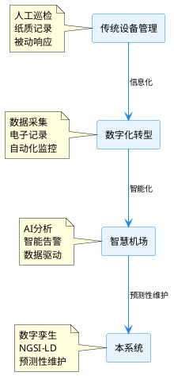

### 1.2 建设目标

系统建设目标围绕五边形能力展开：

```plantuml
@startuml 建设目标图
skinparam backgroundColor #FEFEFE
skinparam defaultFontName "Microsoft YaHei"
skinparam defaultFontSize 12
skinparam circle {
    backgroundColor #E8F4FD
    borderColor #1E88E5
    borderWidth 2
}
skinparam arrowColor #1E88E5

circle "统一管理" as m1
circle "数字孪生" as m2
circle "AI预测" as m3
circle "NGSI-LD" as m4
circle "运维闭环" as m5

m1 --> m2 : 数据支撑
m2 --> m3 : 模型训练
m3 --> m4 : 标准输出
m4 --> m5 : 数据驱动
m5 --> m1 : 优化反馈

note center of m1
  设备全生命周期
  统一监控管理
end note

note center of m2
  3D可视化
  实时状态映射
end note

note center of m3
  趋势预测
  异常检测
end note

note center of m4
  标准化接口
  数据交换
end note

note center of m5
  告警处理
  工单闭环
end note
@enduml
```

### 1.3 系统定位

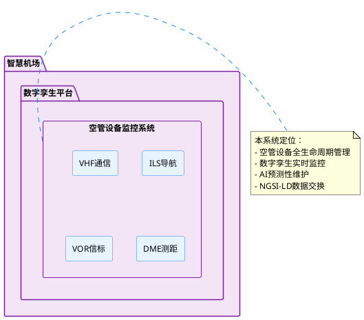

### 1.4 应用范围

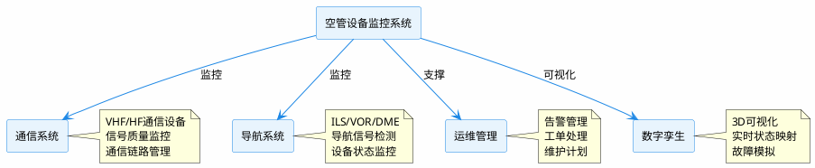

### 1.5 用户角色

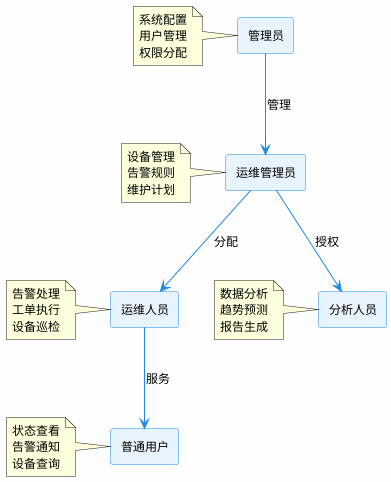

### 1.6 系统功能总图

```plantuml
@startuml 系统功能总图
skinparam backgroundColor #FEFEFE
skinparam defaultFontName "Microsoft YaHei"
skinparam defaultFontSize 12
skinparam rectangle {
    backgroundColor #E8F4FD
    borderColor #1E88E5
    borderWidth 1.5
}
skinparam arrowColor #1E88E5

rectangle "设备管理" as dm
rectangle "实时监控" as rm
rectangle "NGSI-LD接口" as ngsi
rectangle "数字孪生" as dt
rectangle "AI预测" as ai
rectangle "知识图谱" as kg
rectangle "告警管理" as alarm
rectangle "3D可视化" as viz

rectangle "空管设备监控系统" as sys {
  dm
  rm
  ngsi
  dt
  ai
  kg
  alarm
  viz
}

dm --> rm : 数据
rm --> alarm : 触发
rm --> ai : 输入
ai --> dt : 更新
ngsi --> kg : 语义
kg --> alarm : 分析
viz --> dt : 展示

note right of sys
  系统核心功能模块：
  - 8大功能模块
  - 全链路覆盖
  - 数据驱动决策
end note
@enduml
```

### 1.7 系统简介

本项目是一个基于 **Django + Vue 3 + Element Plus** 的工业级空管设备数据集中分析系统的设计与实现，实现了从设备数据采集、告警管理、预测性维护到可视化展示的完整链路。

### 1.8 核心特性

| 模块 | 功能说明 |
|------|----------|
| **设备管理** | 支持设备增删改查、批量导入、阈值配置 |
| **告警中心** | 基于民航标准的阈值告警、确认、处理流程 |
| **预测性维护 2.0** | 健康度评分、趋势预测、风险预警 |
| **根因分析** | 知识图谱 + 图数据库的智能根因定位 |
| **数字孪生** | Three.js 3D 实时监控可视化 |
| **NGSI-LD 集成** | 标准化数据交换接口 |

---

## 第二章 需求分析

### 2.1 业务需求总图

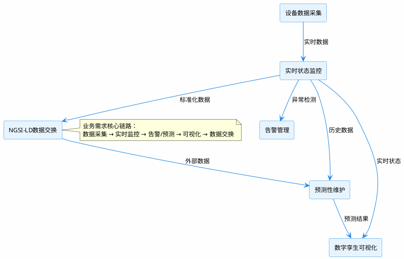

### 2.2 多源数据融合

```plantuml
@startuml 多源融合图
skinparam backgroundColor #FEFEFE
skinparam defaultFontName "Microsoft YaHei"
skinparam defaultFontSize 12
skinparam rectangle {
    backgroundColor #E8F4FD
    borderColor #1E88E5
    borderWidth 1.5
}
skinparam arrowColor #1E88E5

rectangle "设备传感器" as sensor
rectangle "环境监测" as env
rectangle "历史数据" as history
rectangle "外部系统" as external
rectangle "仿真数据" as sim

rectangle "数据融合层" as fusion

sensor --> fusion : 实时状态
env --> fusion : 环境参数
history --> fusion : 历史趋势
external --> fusion : NGSI-LD数据
sim --> fusion : 模拟数据

fusion --> rectangle "统一数据模型" as unified

note right of fusion
  数据融合能力：
  - 多源异构数据整合
  - 时间对齐
  - 质量校验
  - 标准化输出
end note
@enduml
```

### 2.3 实时监控流程

```plantuml
@startuml 实时监控流程
skinparam backgroundColor #FEFEFE
skinparam defaultFontName "Microsoft YaHei"
skinparam defaultFontSize 12
skinparam activityBackgroundColor #E8F4FD
skinparam activityBorderColor #1E88E5
skinparam arrowColor #1E88E5

start : 设备数据采集

:数据预处理\n(过滤/校准/格式化);

:存储到数据库;

:更新实时状态;

if (阈值检测?) then (异常)
  :触发告警;
else (正常)
  :继续监控;
endif

:更新数字孪生;

:推送WebSocket通知;

stop
@enduml
```

### 2.4 设备关联关系

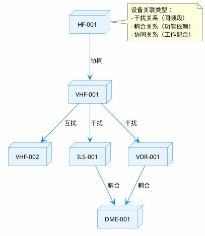

### 2.5 数字孪生业务流程

```plantuml
@startuml 数字孪生业务流程
skinparam backgroundColor #FEFEFE
skinparam defaultFontName "Microsoft YaHei"
skinparam defaultFontSize 12
skinparam activityBackgroundColor #E8F4FD
skinparam activityBorderColor #1E88E5
skinparam arrowColor #1E88E5

start : 设备状态采集

:构建数字孪生模型;

:实时状态同步;

if (状态变化?) then (是)
  :更新3D可视化;
else (否)
  :等待下一周期;
endif

:触发预测分析;

:生成预警信息;

:更新孪生模型;

stop
@enduml
```

### 2.6 智能预测流程

```plantuml
@startuml 智能预测流程
skinparam backgroundColor #FEFEFE
skinparam defaultFontName "Microsoft YaHei"
skinparam defaultFontSize 12
skinparam activityBackgroundColor #E8F4FD
skinparam activityBorderColor #1E88E5
skinparam arrowColor #1E88E5

start : 历史数据获取

:特征工程\n(时间特征/统计特征/耦合特征);

:物理模型预测;

:AI残差校正;

:融合预测结果;

:计算置信度;

if (置信度达标?) then (是)
  :输出预测结果;
else (否)
  :标记低置信度;
endif

:存储预测记录;

:触发预警(如需);

stop
@enduml
```

### 2.7 告警闭环流程

```plantuml
@startuml 告警闭环流程
skinparam backgroundColor #FEFEFE
skinparam defaultFontName "Microsoft YaHei"
skinparam defaultFontSize 12
skinparam activityBackgroundColor #E8F4FD
skinparam activityBorderColor #1E88E5
skinparam arrowColor #1E88E5

start : 检测到异常

:生成告警;

:发送通知;

:创建工单;

:工单分配;

:执行处理;

:验证恢复;

if (问题解决?) then (是)
  :清除告警;
else (否)
  :升级处理;
endif

:记录处理日志;

stop
@enduml
```

### 2.8 功能需求树

```plantuml
@startuml 功能需求树
skinparam backgroundColor #FEFEFE
skinparam defaultFontName "Microsoft YaHei"
skinparam defaultFontSize 12
skinparam rectangle {
    backgroundColor #E8F4FD
    borderColor #1E88E5
    borderWidth 1.5
}
skinparam arrowColor #1E88E5

rectangle "空管设备监控系统" as root

root --> rectangle "设备管理" as dm
dm --> rectangle "设备注册"
dm --> rectangle "信息维护"
dm --> rectangle "阈值配置"
dm --> rectangle "批量导入"

root --> rectangle "实时监控" as rm
rm --> rectangle "状态采集"
rm --> rectangle "数据展示"
rm --> rectangle "历史查询"
rm --> rectangle "趋势分析"

root --> rectangle "告警管理" as alarm
alarm --> rectangle "规则配置"
alarm --> rectangle "告警触发"
alarm --> rectangle "告警确认"
alarm --> rectangle "告警统计"

root --> rectangle "预测性维护" as pm
pm --> rectangle "健康度评估"
pm --> rectangle "趋势预测"
pm --> rectangle "风险预警"
pm --> rectangle "维护建议"

root --> rectangle "数字孪生" as dt
dt --> rectangle "3D可视化"
dt --> rectangle "状态映射"
dt --> rectangle "故障模拟"
dt --> rectangle "空间分析"

root --> rectangle "NGSI-LD接口" as ngsi
ngsi --> rectangle "实体管理"
ngsi --> rectangle "数据查询"
ngsi --> rectangle "数据导出"
ngsi --> rectangle "订阅推送"
@enduml
```

### 2.9 非功能需求图

```plantuml
@startuml 非功能需求图
skinparam backgroundColor #FEFEFE
skinparam defaultFontName "Microsoft YaHei"
skinparam defaultFontSize 12
skinparam circle {
    backgroundColor #E8F4FD
    borderColor #1E88E5
    borderWidth 2
}
skinparam arrowColor #1E88E5

circle "性能" as perf
circle "可靠性" as rel
circle "安全性" as sec
circle "可扩展性" as ext
circle "可维护性" as main

perf --> rel : 支撑
rel --> sec : 保障
sec --> ext : 基础
ext --> main : 提升
main --> perf : 优化

note center of perf
  响应时间 < 1s
  数据更新频率 1s
  并发支持 1000+
end note

note center of rel
  可用性 99.9%
  数据持久性
  故障自动恢复
end note

note center of sec
  数据加密
  权限控制
  审计日志
end note

note center of ext
  水平扩展
  模块插件化
  标准接口
end note

note center of main
  代码可读性
  文档完整性
  监控可观测
end note
@enduml
```

### 2.10 系统质量属性图

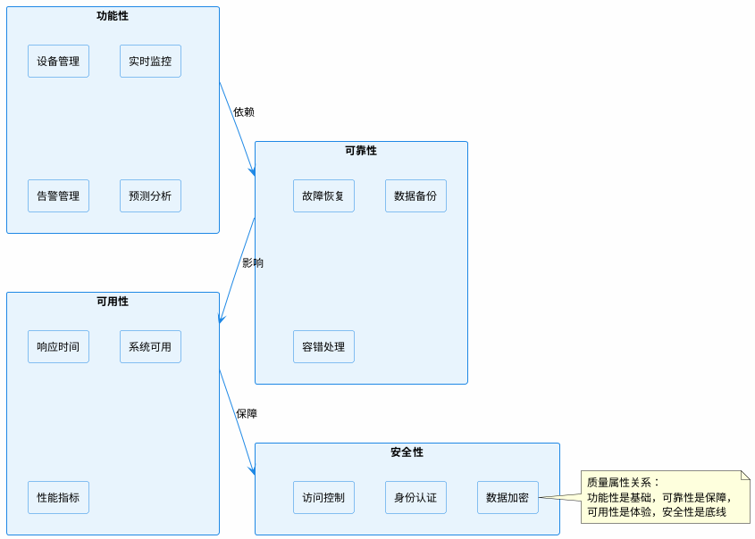

### 2.11 快速开始

#### 前置条件

- **后端**: Python 3.9+, Django 4.1+
- **前端**: Node.js 16+, Vue 3.5+
- **数据库**: SQLite / PostgreSQL
- **可选**: Redis, Neo4j, TimescaleDB

#### 安装与运行

##### 1. 后端设置

```bash
cd ACT

# 创建虚拟环境
python -m venv venv

# Windows 激活
venv\Scripts\activate
# Linux/Mac 激活
source venv/bin/activate

# 安装依赖
pip install -r requirements.txt

# 初始化数据库
python manage.py makemigrations
python manage.py migrate

# 创建管理员
python manage.py createsuperuser

# 初始化民航标准阈值
python manage.py init_thresholds

# 启动开发服务器
python manage.py runserver
```

#### 2. 前端设置

```bash
cd frontend

# 安装依赖
npm install

# 启动开发服务器
npm run dev

# 构建生产版本
npm run build
```

---

## 第三章 系统总体设计

### 3.1 总体技术架构

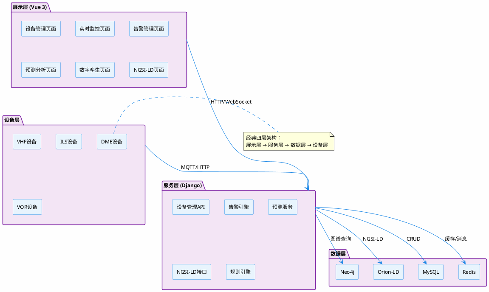

### 3.2 系统部署架构

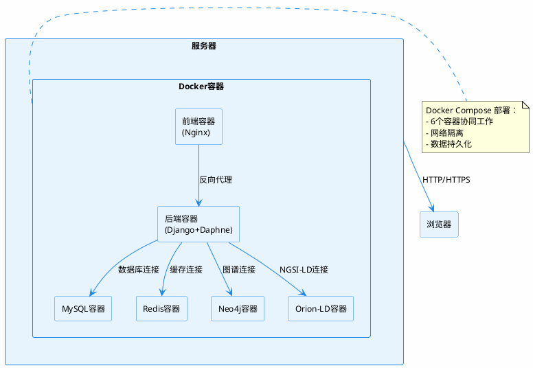

### 3.3 微服务关系图

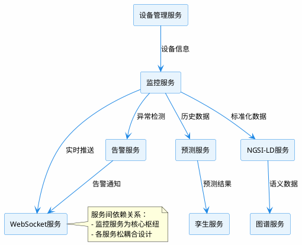

### 3.4 数据流图

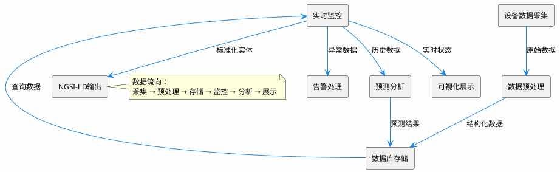

### 3.5 网络拓扑图

```plantuml
@startuml 网络拓扑图
skinparam backgroundColor #FEFEFE
skinparam defaultFontName "Microsoft YaHei"
skinparam defaultFontSize 12
skinparam rectangle {
    backgroundColor #E8F4FD
    borderColor #1E88E5
    borderWidth 1.5
}
skinparam arrowColor #1E88E5

rectangle "用户端" as client {
  rectangle "浏览器"
  rectangle "移动端"
}

rectangle "防火墙" as firewall

rectangle "服务器集群" as cluster {
  rectangle "前端服务器" as web
  rectangle "后端服务器" as api
  rectangle "数据库服务器" as db
}

rectangle "设备端" as devices {
  rectangle "VHF设备"
  rectangle "ILS设备"
  rectangle "环境传感器"
}

client --> firewall : HTTPS
firewall --> web : HTTP
firewall --> api : API请求
web --> api : 数据请求
api --> db : 数据库访问
devices --> api : MQTT/HTTP

note right
  网络安全架构：
  - 防火墙隔离
  - HTTPS加密
  - API认证授权
end note
@enduml
```

### 3.6 前后端交互图

```plantuml
@startuml 前后端交互图
skinparam backgroundColor #FEFEFE
skinparam defaultFontName "Microsoft YaHei"
skinparam defaultFontSize 12
skinparam participant {
    backgroundColor #E8F4FD
    borderColor #1E88E5
}
skinparam arrowColor #1E88E5

participant "前端(Vue)" as frontend
participant "后端(Django)" as backend
participant "数据库" as db
participant "WebSocket" as ws

frontend -> backend: 登录请求
backend -> db: 查询用户
db --> backend: 返回用户信息
backend --> frontend: 返回Token

frontend -> backend: 查询设备列表
backend -> db: 查询设备
db --> backend: 返回设备数据
backend --> frontend: 返回设备列表

frontend -> ws: 建立WebSocket连接
ws -> backend: 注册连接

backend -> ws: 推送实时状态
ws --> frontend: 接收实时状态

frontend -> backend: 触发告警确认
backend -> db: 更新告警状态
db --> backend: 更新成功
backend --> frontend: 确认成功

note right
  交互模式：
  - REST API：请求-响应
  - WebSocket：实时推送
end note
@enduml
```

### 3.7 WebSocket流程

```plantuml
@startuml WebSocket流程
skinparam backgroundColor #FEFEFE
skinparam defaultFontName "Microsoft YaHei"
skinparam defaultFontSize 12
skinparam participant {
    backgroundColor #E8F4FD
    borderColor #1E88E5
}
skinparam arrowColor #1E88E5

participant "客户端" as client
participant "WebSocket服务器" as server
participant "Django Channels" as channels
participant "Redis" as redis

client -> server: WebSocket握手请求
server -> channels: 连接请求
channels -> redis: 注册频道
redis --> channels: 注册成功
channels --> server: 连接建立
server --> client: WebSocket握手响应

client -> server: 发送订阅消息
server -> channels: 订阅请求
channels -> redis: 加入频道组
redis --> channels: 加入成功

channels -> server: 实时数据到达
server -> client: 推送实时状态

client -> server: 断开连接请求
server -> channels: 断开请求
channels -> redis: 注销频道
redis --> channels: 注销成功
channels --> server: 断开成功
server --> client: 断开响应

note right
  WebSocket生命周期：
  握手 → 订阅 → 推送 → 断开
end note
@enduml
```

### 3.8 技术栈图

```plantuml
@startuml 技术栈图
skinparam backgroundColor #FEFEFE
skinparam defaultFontName "Microsoft YaHei"
skinparam defaultFontSize 12
skinparam rectangle {
    backgroundColor #E8F4FD
    borderColor #1E88E5
    borderWidth 1.5
}
skinparam arrowColor #1E88E5

rectangle "前端技术栈" as frontend {
  rectangle "Vue 3"
  rectangle "TypeScript"
  rectangle "Element Plus"
  rectangle "Three.js"
  rectangle "Vite"
}

rectangle "后端技术栈" as backend {
  rectangle "Python 3.9+"
  rectangle "Django 4.1+"
  rectangle "Django REST Framework"
  rectangle "Django Channels"
  rectangle "Daphne"
}

rectangle "数据库技术栈" as db {
  rectangle "MySQL"
  rectangle "Redis"
  rectangle "Neo4j"
}

rectangle "标准与协议" as protocol {
  rectangle "NGSI-LD"
  rectangle "MQTT"
  rectangle "WebSocket"
  rectangle "RESTful API"
}

frontend --> backend : HTTP/WebSocket
backend --> db : 数据存储
backend --> protocol : 标准协议

note right
  完整技术栈：
  Vue 3 + Django + MySQL + Redis + Neo4j
end note
@enduml
```

---

## 第四章 数据模型设计

### 4.1 E-R图

```plantuml
@startuml E-R图
skinparam backgroundColor #FEFEFE
skinparam defaultFontName "Microsoft YaHei"
skinparam defaultFontSize 12
skinparam entity {
    backgroundColor #E8F4FD
    borderColor #1E88E5
    borderWidth 1.5
}
skinparam arrowColor #1E88E5

entity "Device" as device {
    * device_id : String
    * device_name : String
    * device_type : String
    * status : String
    --
    * position_x : Decimal
    * position_y : Decimal
    * position_z : Decimal
}

entity "DeviceStatusLog" as status_log {
    * id : Long
    * timestamp : DateTime
    * power_voltage : Decimal
    * device_temperature : Decimal
    --
    * signal_strength : Decimal
    * link_status : String
}

entity "Alarm" as alarm {
    * id : Long
    * alarm_code : String
    * alarm_level : String
    * alarm_status : String
    * timestamp : DateTime
}

entity "AlarmRule" as alarm_rule {
    * id : Long
    * rule_name : String
    * device_type : String
    * metric : String
    * operator : String
    * threshold : Decimal
}

entity "PredictionResult" as prediction {
    * id : Long
    * device_id : String
    * prediction_type : String
    * predicted_value : Decimal
    * confidence : Decimal
    * timestamp : DateTime
}

entity "User" as user {
    * id : Long
    * username : String
    * email : String
    * role : String
}

device ||--o{ status_log : "has"
device ||--o{ alarm : "triggers"
device ||--o{ prediction : "predicts"
alarm_rule ||--o{ alarm : "generates"
user ||--o{ device : "owns"

note right
  核心实体关系：
  - 设备产生状态日志
  - 设备触发告警
  - 告警规则生成告警
  - 用户拥有设备
end note
@enduml
```

### 4.2 MySQL关系图

```plantuml
@startuml MySQL关系图
skinparam backgroundColor #FEFEFE
skinparam defaultFontName "Microsoft YaHei"
skinparam defaultFontSize 12
skinparam rectangle {
    backgroundColor #E8F4FD
    borderColor #1E88E5
    borderWidth 1.5
}
skinparam arrowColor #1E88E5

rectangle "monitor_device" as device {
    device_id (PK)
    device_name
    device_type
    status
    owner_id (FK)
    position_x
    position_y
    position_z
}

rectangle "devicestatuslog" as status_log {
    id (PK)
    device_id (FK)
    timestamp
    power_voltage
    device_temperature
    signal_strength
    link_status
}

rectangle "alarm" as alarm {
    id (PK)
    device_id (FK)
    alarm_code
    alarm_level
    alarm_status
    timestamp
}

rectangle "alarmrule" as alarm_rule {
    id (PK)
    rule_name
    device_type
    metric
    operator
    threshold
}

rectangle "predictionresult" as prediction {
    id (PK)
    device_id (FK)
    prediction_type
    predicted_value
    confidence
    timestamp
}

rectangle "auth_user" as user {
    id (PK)
    username
    email
    password
    role
}

device --> status_log : device_id
device --> alarm : device_id
device --> prediction : device_id
user --> device : id
alarm_rule -[dashed]-> alarm : rule_id

note right
  MySQL表关系：
  - 设备表为核心关联表
  - 状态日志、告警、预测均关联设备
  - 用户表通过owner_id关联设备
end note
@enduml
```

### 4.3 Mongo结构

```plantuml
@startuml Mongo结构
skinparam backgroundColor #FEFEFE
skinparam defaultFontName "Microsoft YaHei"
skinparam defaultFontSize 12
skinparam rectangle {
    backgroundColor #E3F2FD
    borderColor #1976D2
    borderWidth 1.5
}
skinparam arrowColor #1976D2

rectangle "MongoDB" as mongo {
    rectangle "device_profiles" as profiles {
        {field} _id
        {field} device_id
        {field} device_type
        {field} specifications
        {field} calibration_data
        {field} maintenance_history
    }
    
    rectangle "raw_sensor_data" as raw {
        {field} _id
        {field} device_id
        {field} timestamp
        {field} sensor_values
        {field} dataSource
    }
    
    rectangle "analysis_results" as analysis {
        {field} _id
        {field} device_id
        {field} analysis_type
        {field} results
        {field} timestamp
        {field} confidence
    }
    
    rectangle "ngsi_ld_entities" as ngsi {
        {field} _id
        {field} entity_id
        {field} entity_type
        {field} properties
        {field} relationships
        {field} @context
    }
}

note right of mongo
  MongoDB集合：
  - device_profiles: 设备配置文件
  - raw_sensor_data: 原始传感器数据
  - analysis_results: 分析结果
  - ngsi_ld_entities: NGSI-LD实体缓存
end note
@enduml
```

### 4.4 Neo4j关系

```plantuml
@startuml Neo4j关系
skinparam backgroundColor #FEFEFE
skinparam defaultFontName "Microsoft YaHei"
skinparam defaultFontSize 12
skinparam node {
    backgroundColor #F3E5F5
    borderColor #7B1FA2
    borderWidth 2
}
skinparam arrowColor #7B1FA2

node "VHF-001" as vhf1
node "VHF-002" as vhf2
node "ILS-001" as ils1
node "VOR-001" as vor1
node "DME-001" as dme1
node "Airport" as airport
node "Tower" as tower

vhf1 -[#e74c3c, label="interferes"]-> ils1
vhf1 -[#e74c3c, label="interferes"]-> vor1
ils1 -[#3498db, label="locatedAt"]-> airport
vor1 -[#3498db, label="locatedAt"]-> airport
dme1 -[#f39c12, label="dependsOn"]-> vor1
vhf1 -[#27ae60, label="supports"]-> tower
vhf2 -[#9b59b6, label="connectedTo"]-> vhf1

note right
  Neo4j图谱关系类型：
  - interferes: 干扰关系(红色)
  - locatedAt: 位置关系(蓝色)
  - dependsOn: 依赖关系(橙色)
  - supports: 支撑关系(绿色)
  - connectedTo: 连接关系(紫色)
end note
@enduml
```

### 4.5 Redis缓存

```plantuml
@startuml Redis缓存
skinparam backgroundColor #FEFEFE
skinparam defaultFontName "Microsoft YaHei"
skinparam defaultFontSize 12
skinparam rectangle {
    backgroundColor #FFF8E1
    borderColor #FF9800
    borderWidth 1.5
}
skinparam arrowColor #FF9800

rectangle "Redis缓存层" as redis {
    rectangle "设备状态缓存\n(device:status:{id})" as status_cache
    rectangle "告警计数缓存\n(alarm:count:daily)" as alarm_cache
    rectangle "预测结果缓存\n(prediction:{id})" as predict_cache
    rectangle "知识图谱缓存\n(graph:device:{id})" as graph_cache
    rectangle "用户Session\n(session:{token})" as session_cache
    rectangle "WebSocket频道\n(channel:device:{id})" as ws_cache
}

rectangle "Django应用" as django
rectangle "MySQL数据库" as mysql

django --> redis : 读取缓存
redis --> django : 返回缓存数据

note right
  Redis缓存策略：
  - 设备状态：5分钟过期
  - 告警计数：1小时过期
  - 预测结果：10分钟过期
  - 用户Session：30分钟过期
end note
@enduml
```

### 4.6 文件结构

```plantuml
@startuml 文件结构
skinparam backgroundColor #FEFEFE
skinparam defaultFontName "Microsoft YaHei"
skinparam defaultFontSize 12
skinparam folder {
    backgroundColor #E8F4FD
    borderColor #1E88E5
}
skinparam arrowColor #1E88E5

folder "ACT/" as act {
    folder "atc_monitor/" as config {
        file "settings.py"
        file "urls.py"
        file "asgi.py"
        file "wsgi.py"
    }
    
    folder "core/" as core {
        folder "ai/" as ai {
            file "inference.py"
            file "model_trainer.py"
            file "feature_extractor.py"
        }
        folder "knowledge_graph/" as kg {
            file "device_graph.py"
            file "graph_client.py"
        }
        folder "ngsi_ld/" as ngsi {
            file "converter.py"
            file "entity_factory.py"
        }
        folder "simulation/" as sim {
            file "coupling_matrix.py"
            file "data_generator.py"
        }
    }
    
    folder "monitor/" as monitor {
        file "models.py"
        file "views.py"
        file "consumers.py"
        file "health_service.py"
        file "standard_thresholds.py"
    }
    
    folder "frontend/" as frontend {
        folder "src/" as src {
            folder "views/" as views
            folder "components/" as components
            folder "api/" as api
            folder "router/" as router
            file "main.ts"
        }
    }
    
    file "manage.py"
    file "requirements.txt"
}

note right
  项目文件结构：
  - atc_monitor: Django配置
  - core: 核心模块(AI/图谱/NGSI-LD/仿真)
  - monitor: 监控应用
  - frontend: 前端应用
end note
@enduml
```

### 4.7 数据流

```plantuml
@startuml 数据流
skinparam backgroundColor #FEFEFE
skinparam defaultFontName "Microsoft YaHei"
skinparam defaultFontSize 12
skinparam activityBackgroundColor #E8F4FD
skinparam activityBorderColor #1E88E5
skinparam arrowColor #1E88E5

rectangle "设备端" as devices
rectangle "数据采集层" as collect
rectangle "数据处理层" as process
rectangle "存储层" as storage
rectangle "服务层" as service
rectangle "展示层" as display

devices --> collect : MQTT/HTTP
collect --> process : 原始数据
process --> storage : 结构化数据
storage --> service : 查询
service --> display : API响应

storage --> rectangle "MySQL" as mysql
storage --> rectangle "MongoDB" as mongo
storage --> rectangle "Redis" as redis
storage --> rectangle "Neo4j" as neo4j

note right
  数据流向：
  设备端 → 采集层 → 处理层 → 存储层 → 服务层 → 展示层
  存储层包含4种数据库：MySQL/MongoDB/Redis/Neo4j
end note
@enduml
```

### 4.8 数据生命周期

```plantuml
@startuml 数据生命周期
skinparam backgroundColor #FEFEFE
skinparam defaultFontName "Microsoft YaHei"
skinparam defaultFontSize 12
skinparam activityBackgroundColor #E8F4FD
skinparam activityBorderColor #1E88E5
skinparam arrowColor #1E88E5

start : 数据产生

:数据采集\n(传感器/模拟);

:数据传输\n(MQTT/HTTP);

:数据存储\n(MySQL/MongoDB);

:数据处理\n(清洗/转换/融合);

:数据分析\n(AI预测/图谱分析);

:数据展示\n(可视化/报表);

:数据归档\n(历史数据存储);

if (数据过期?) then (是)
  :数据删除;
else (否)
  :保留数据;
endif

stop

note right
  数据生命周期：
  产生 → 采集 → 传输 → 存储 → 处理 → 分析 → 展示 → 归档 → 删除
end note
@enduml
```

### 4.9 项目功能详解

#### 4.1.1 标准阈值系统 (民航标准)

**文件位置**: `monitor/standard_thresholds.py`

#### 支持的设备类型

| 设备类型 | 标准来源 | 关键属性 |
|---------|---------|---------|
| VHF (甚高频通信设备) | 厂家手册 + ICAO 标准 | 信号强度、电源电压、驻波比、温度 |
| ILS (仪表着陆系统) | ICAO Annex 10 | 信号功率、DDM偏差、链路状态 |
| VOR (全向信标) | ICAO Annex 10 | 方位角误差、射频功率、调制度差 |
| DME (测距仪) | ICAO Annex 10 | 应答效率、脉冲间隔、发射功率 |
| HF (短波通信设备) | 民航标准 | 发射功率、工作频率、驻波比 |

#### 阈值等级

- **标准范围**: 设备正常工作的最佳参数区间
- **预警门限**: 超出此范围需要关注，但不影响正常运行
- **硬告警门限**: 必须立即处理的安全阈值

---

### 2. 规则引擎 (Rule Engine)

**核心模块**: `core/rule_engine/`

#### 评估流程

```
设备状态上报
    ↓
Rule Engine 评估
    ├─→ 标准阈值评估 (优先)
    ├─→ 自定义规则评估
    └─→ 告警产生
```

#### API 端点

- `/api/alarms/` - 告警列表
- `/api/alarms/{id}/ack/` - 告警确认
- `/api/alarms/{id}/clear/` - 告警处理

---

### 3. 预测性维护 2.0 (Predictive Maintenance)

**核心服务**: `monitor/health_service.py`

#### 健康度评分维度

| 维度 | 权重 | 说明 |
|------|------|------|
| 信号质量 | 0.3 | 当前信号强度与标准的偏差 |
| 设备温度 | 0.2 | 温度与阈值的比较 |
| 历史告警 | 0.2 | 近期告警频率和严重程度 |
| 运行时长 | 0.15 | 设备使用时长与折旧 |
| 环境影响 | 0.15 | 温湿度、干扰等环境因素 |

#### 健康等级

| 健康度区间 | 等级 | 建议操作 |
|-----------|------|---------|
| ≥ 85 | 健康 | 正常运行 |
| 70 - 84 | 关注 | 增加巡检频率 |
| 50 - 69 | 预警 | 制定维护计划 |
| < 50 | 高危 | 立即安排维修 |

#### API 端点

- `/api/predictions/health-summary/` - 健康度汇总
- `/api/predictions/health-detail/` - 单设备健康详情
- `/api/predictions/recalculate/` - 重新计算预测

---

### 4. 根因分析 (Root Cause Analysis)

**核心服务**: `monitor/graph_service.py`

#### 分析流程

```
告警触发
    ↓
查询知识图谱
    ├─→ 相关设备
    ├─→ 历史告警
    └─→ 环境关联
    ↓
生成根因候选列表
    ↓
计算置信度和路径
```

#### API 端点

- `/api/root-cause/graph/` - 获取根因图谱
- `/api/root-cause/path/` - 获取分析路径
- `/api/root-cause/sync/` - 同步知识图谱

---

### 5. 数据库可视化 (Database Visualization)

**前端页面**: `frontend/src/views/DatabaseVisualization.vue`

#### 展示内容

- **统计概览**: 设备总数、告警总数、状态日志、规则总数
- **设备类型分布**: 饼图展示各类设备占比
- **告警状态分布**: 柱状图展示待确认/已确认/已处理
- **30天增长趋势**: 折线图展示数据随时间变化
- **数据库表结构**: 可视化展示核心表和字段

#### API 端点

- `/api/database/stats/` - 获取统计数据
- `/api/database/schema/` - 获取表结构

---

### 6. 告警确认 (Alarm Confirmation)

**前端页面**: `frontend/src/views/AlarmCenter/AlarmConfirmation.vue`

#### 功能特性

- **标签页导航**: 待确认 / 已确认 / 已处理 / 全部
- **智能筛选**: 按告警级别、设备类型、关键词筛选
- **响应时长**: 自动计算并显示告警响应时间
- **批量操作**: 支持批量确认和批量处理
- **详情弹窗**: 查看完整告警信息和时间线

#### UI 风格

- **极简设计**: 清爽的界面，减少视觉干扰
- **高对比度**: 关键信息突出显示
- **平滑过渡**: 所有交互都有动画效果

---

### 7. NGSI-LD 集成

**核心模块**: `core/ngsi_ld.py`

#### 数据格式

遵循 ETSI GS CIM 009 标准，支持：
- 设备实体
- 告警实体
- 观测数据
- 预测数据

#### API 端点

- `/api/ngsi/` - NGSI-LD 根路径
- `/api/ngsi/entities/` - 实体查询
- `/api/ngsi/query/` - 标准查询接口

---

## 🎨 前端页面导航

| 路由 | 页面 | 说明 |
|------|------|------|
| `/dashboard` | 仪表盘 | 系统概览和关键指标 |
| `/realtime-monitor` | 实时监控 (3D) | Three.js 数字孪生可视化 |
| `/devices` | 设备列表 | 设备管理和批量操作 |
| `/device-detail/:id` | 设备详情 | 单设备详细信息 |
| `/alarm-center/list` | 告警列表 | 告警查看和筛选 |
| `/alarm-center/handling` | 告警处理 | 处理进行中的告警 |
| `/alarm-center/confirmation` | 告警确认 | 极简确认界面 |
| `/data-analysis` | 数据分析 | 趋势分析和报表 |
| `/operation-management` | 运维管理 | 工单和维护计划 |
| `/root-cause-analysis` | 根因分析 | 知识图谱根因定位 |
| `/ngsi-exchange` | NGSI-LD 数据交换 | 标准化数据接口 |
| `/database` | 数据库可视化 | 数据统计和表结构 |
| `/predictive-maintenance` | 预测性维护 2.0 | 健康度和风险预警 |

---

## 🛠️ 开发指南

### 后端目录结构

```
ACT/
├── atc_monitor/          # Django 项目配置
├── core/                 # 核心模块
│   ├── rule_engine/      # 规则引擎
│   ├── ai/              # 预测模型
│   └── ngsi_ld.py       # NGSI-LD 转换
├── monitor/             # 监控应用
│   ├── models.py        # 数据模型
│   ├── views.py         # API 视图
│   ├── standard_thresholds.py  # 标准阈值
│   └── health_service.py       # 健康度服务
├── frontend/            # 前端应用
│   └── src/
│       ├── views/       # 页面组件
│       └── api/         # API 调用
└── manage.py
```

### 前端目录结构

```
frontend/src/
├── views/
│   ├── dashboard.vue              # 仪表盘
│   ├── RealtimeMonitor.vue        # 实时监控
│   ├── DeviceList.vue             # 设备列表
│   ├── AlarmCenter/               # 告警中心
│   ├── DataAnalysis.vue           # 数据分析
│   ├── OperationCenter.vue        # 运维管理
│   ├── RootCauseAnalysis.vue      # 根因分析
│   ├── DatabaseVisualization.vue  # 数据库可视化
│   └── PredictiveMaintenance.vue  # 预测性维护
├── api/
│   └── device.ts                  # API 封装
├── router/
│   └── index.ts                   # 路由配置
└── main.ts
```

---

## 📊 数据模型说明

### 核心模型

| 模型 | 表名 | 说明 |
|------|------|------|
| `Device` | monitor_device | 设备信息 |
| `DeviceStatusLog` | devicestatuslog | 设备状态记录 |
| `AlarmRule` | alarmrule | 告警规则 |
| `Alarm` | alarm | 告警记录 |
| `AlarmEvent` | alarmevent | 告警事件日志 |
| `PredictionResult` | predictionresult | 预测结果 |
| `EnvironmentData` | environmentdata | 环境数据 |

---

## 🔧 配置与部署

### 环境变量

创建 `.env` 文件：

```
DEBUG=True
SECRET_KEY=your-secret-key
ALLOWED_HOSTS=localhost,127.0.0.1

# 数据库配置
DB_ENGINE=django.db.backends.sqlite3
DB_NAME=db.sqlite3

# Redis 配置 (可选)
REDIS_URL=redis://localhost:6379/1

# Neo4j 配置 (可选)
NEO4J_URL=bolt://localhost:7687
NEO4J_USER=neo4j
NEO4J_PASSWORD=password
```

### Docker 部署

使用 `docker-compose.yml` 一键部署：

```bash
docker-compose up -d
```

---

## 📈 性能优化

### 已实现的优化

1. **数据库查询优化**
   - 使用 `select_related` 和 `prefetch_related` 减少 N+1 查询
   - 索引优化关键查询字段
   - 分页处理大数据列表

2. **缓存策略**
   - Django 缓存框架缓存统计数据
   - 页面级缓存减少重复渲染

3. **前端优化**
   - 路由懒加载
   - ECharts 图表自适应
   - 虚拟滚动长列表

---

## ⚠️ 注意事项

### 开发阶段

1. 确保 Python 和 Node 版本符合要求
2. 首次运行必须初始化数据库
3. 运行 `init_thresholds` 命令加载标准阈值

### 生产部署

1. 使用 PostgreSQL 替代 SQLite
2. 配置 Redis 用于缓存和队列
3. 启用 HTTPS 和安全中间件
4. 配置日志记录和监控告警

---

## 📞 技术支持

如有问题，请参考：
- Django 官方文档: https://docs.djangoproject.com/
- Vue 3 官方文档: https://vuejs.org/
- Element Plus 组件库: https://element-plus.org/

---

## 📝 更新日志

### v2.0 (当前版本)

- ✅ 标准阈值系统集成
- ✅ 预测性维护 2.0
- ✅ 根因分析图谱
- ✅ 数据库可视化
- ✅ 极简告警确认界面
- ✅ 健康度评分体系

---

## 第五章 NGSI-LD语义上下文设计

### 5.1 Entity结构

```plantuml
@startuml Entity结构
skinparam backgroundColor #FEFEFE
skinparam defaultFontName "Microsoft YaHei"
skinparam defaultFontSize 12
skinparam rectangle {
    backgroundColor #E8F4FD
    borderColor #1E88E5
    borderWidth 1.5
}
skinparam arrowColor #1E88E5

rectangle "Device Entity" as device {
    rectangle "id"
    rectangle "type"
    rectangle "@context"
}

rectangle "Property" as property {
    rectangle "type: Property"
    rectangle "value"
    rectangle "observedAt"
    rectangle "dataSource"
}

rectangle "Relationship" as relationship {
    rectangle "type: Relationship"
    rectangle "object"
    rectangle "observedAt"
}

device --> property : "has"
device --> relationship : "has"

note right
  NGSI-LD Entity结构：
  - Entity = id + type + @context
  - Property = 实体属性（值类型）
  - Relationship = 实体关系（引用类型）
end note
@enduml
```

### 5.2 Context结构

```plantuml
@startuml Context结构
skinparam backgroundColor #FEFEFE
skinparam defaultFontName "Microsoft YaHei"
skinparam defaultFontSize 12
skinparam rectangle {
    backgroundColor #E8F4FD
    borderColor #1E88E5
    borderWidth 1.5
}
skinparam arrowColor #1E88E5

rectangle "@context" as context {
    rectangle "NGSI-LD Core Context" as core
    rectangle "ATC Monitor Context" as atc
    rectangle "Custom Context" as custom
}

rectangle "Device" as device
rectangle "Alarm" as alarm
rectangle "Prediction" as prediction

core --> device : "defines"
atc --> device : "extends"
atc --> alarm : "defines"
atc --> prediction : "defines"
custom --> device : "customizes"

note right
  Context层级结构：
  - Core Context: NGSI-LD标准上下文
  - ATC Context: 空管领域上下文
  - Custom Context: 自定义扩展上下文
end note
@enduml
```

### 5.3 Device实体

```plantuml
@startuml Device实体
skinparam backgroundColor #FEFEFE
skinparam defaultFontName "Microsoft YaHei"
skinparam defaultFontSize 12
skinparam rectangle {
    backgroundColor #E8F4FD
    borderColor #1E88E5
    borderWidth 1.5
}
skinparam arrowColor #1E88E5

rectangle "Device Entity" as device {
    {field} id: urn:ngsi-ld:Device:VHF-001
    {field} type: Device
    {field} @context: [...]
    --
    {field} deviceName: Property
    {field} deviceType: Property
    {field} status: Property
    {field} powerVoltage: Property
    {field} deviceTemperature: Property
    {field} signalStrength: Property
    --
    {field} locatedAt: Relationship
    {field} connectedTo: Relationship
    {field} interferesWith: Relationship
}

note right
  Device实体属性：
  - 基础属性：deviceName, deviceType, status
  - 物理属性：powerVoltage, deviceTemperature, signalStrength
  - 关系属性：locatedAt, connectedTo, interferesWith
end note
@enduml
```

### 5.4 Alarm实体

```plantuml
@startuml Alarm实体
skinparam backgroundColor #FEFEFE
skinparam defaultFontName "Microsoft YaHei"
skinparam defaultFontSize 12
skinparam rectangle {
    backgroundColor #FFEBEE
    borderColor #E53935
    borderWidth 1.5
}
skinparam arrowColor #E53935

rectangle "Alarm Entity" as alarm {
    {field} id: urn:ngsi-ld:Alarm:ALM-001
    {field} type: Alarm
    {field} @context: [...]
    --
    {field} alarmCode: Property
    {field} alarmLevel: Property
    {field} alarmStatus: Property
    {field} description: Property
    {field} timestamp: Property
    {field} dataSource: Property
    --
    {field} triggeredBy: Relationship
    {field} affects: Relationship
}

note right
  Alarm实体属性：
  - 基础属性：alarmCode, alarmLevel, alarmStatus
  - 描述属性：description, timestamp, dataSource
  - 关系属性：triggeredBy(触发设备), affects(影响设备)
end note
@enduml
```

### 5.5 Prediction实体

```plantuml
@startuml Prediction实体
skinparam backgroundColor #FEFEFE
skinparam defaultFontName "Microsoft YaHei"
skinparam defaultFontSize 12
skinparam rectangle {
    backgroundColor #FFF3E0
    borderColor #FF9800
    borderWidth 1.5
}
skinparam arrowColor #FF9800

rectangle "Prediction Entity" as prediction {
    {field} id: urn:ngsi-ld:Prediction:PRED-001
    {field} type: Prediction
    {field} @context: [...]
    --
    {field} predictionType: Property
    {field} predictedValue: Property
    {field} confidence: Property
    {field} forecastTime: Property
    {field} dataSource: Property
    {field} warningLevel: Property
    --
    {field} predicts: Relationship
    {field} basedOn: Relationship
}

note right
  Prediction实体属性：
  - 预测属性：predictionType, predictedValue, confidence
  - 时间属性：forecastTime, dataSource
  - 预警属性：warningLevel
  - 关系属性：predicts(预测对象), basedOn(基于数据)
end note
@enduml
```

### 5.6 Relationship图

```plantuml
@startuml Relationship图
skinparam backgroundColor #FEFEFE
skinparam defaultFontName "Microsoft YaHei"
skinparam defaultFontSize 12
skinparam node {
    backgroundColor #E8F4FD
    borderColor #1E88E5
    borderWidth 2
}
skinparam arrowColor #1E88E5

node "Device" as device
node "Alarm" as alarm
node "Prediction" as prediction
node "Airport" as airport
node "Tower" as tower
node "MaintenanceTask" as task

device -[#E53935, label="triggers"]-> alarm
device -[#FF9800, label="predicts"]-> prediction
device -[#3498db, label="locatedAt"]-> airport
device -[#27ae60, label="monitoredBy"]-> tower
alarm -[#9b59b6, label="creates"]-> task
prediction -[#E53935, label="triggers"]-> alarm

note right
  NGSI-LD关系类型：
  - triggers: 触发关系(红色)
  - predicts: 预测关系(橙色)
  - locatedAt: 位置关系(蓝色)
  - monitoredBy: 监控关系(绿色)
  - creates: 创建关系(紫色)
end note
@enduml
```

### 5.7 Subscription流程

```plantuml
@startuml Subscription流程
skinparam backgroundColor #FEFEFE
skinparam defaultFontName "Microsoft YaHei"
skinparam defaultFontSize 12
skinparam participant {
    backgroundColor #E8F4FD
    borderColor #1E88E5
}
skinparam arrowColor #1E88E5

participant "客户端" as client
participant "Orion-LD" as orion
participant "数据库" as db
participant "通知端点" as endpoint

client -> orion: 创建Subscription
orion -> db: 存储订阅信息
db --> orion: 存储成功
orion --> client: 返回Subscription ID

... 设备状态变化 ...

orion -> db: 查询订阅
db --> orion: 返回匹配订阅
orion -> endpoint: 发送通知
endpoint --> orion: 确认收到

note right
  NGSI-LD订阅流程：
  1. 创建订阅 → 存储
  2. 事件触发 → 查询订阅
  3. 发送通知 → 确认
end note
@enduml
```

---

## 第六章 数字孪生与图动力学模型

### 6.1 数字孪生架构

```plantuml
@startuml 数字孪生架构
skinparam backgroundColor #FEFEFE
skinparam defaultFontName "Microsoft YaHei"
skinparam defaultFontSize 12
skinparam package {
    backgroundColor #E8F4FD
    borderColor #1E88E5
    borderWidth 1.5
}
skinparam arrowColor #1E88E5

package "物理设备层" as physical {
    rectangle "VHF设备"
    rectangle "ILS设备"
    rectangle "VOR设备"
    rectangle "环境传感器"
}

package "数据采集层" as collect {
    rectangle "数据采集器"
    rectangle "数据预处理"
    rectangle "数据质量校验"
}

package "数字孪生层" as dt {
    rectangle "设备模型"
    rectangle "状态映射"
    rectangle "图动力学引擎"
    rectangle "耦合模型"
}

package "可视化层" as viz {
    rectangle "3D渲染"
    rectangle "实时状态展示"
    rectangle "故障模拟"
}

physical --> collect : MQTT/HTTP
collect --> dt : 实时数据
dt --> viz : 孪生状态
viz --> dt : 交互操作

note right
  数字孪四层架构：
  物理层 → 采集层 → 孪层 → 可视化层
end note
@enduml
```

### 6.2 状态映射

```plantuml
@startuml 状态映射
skinparam backgroundColor #FEFEFE
skinparam defaultFontName "Microsoft YaHei"
skinparam defaultFontSize 12
skinparam rectangle {
    backgroundColor #E8F4FD
    borderColor #1E88E5
    borderWidth 1.5
}
skinparam arrowColor #1E88E5

rectangle "物理设备状态" as physical {
    rectangle "温度: 45°C"
    rectangle "电压: 220V"
    rectangle "信号强度: -50dBm"
    rectangle "链路状态: CONNECTED"
}

rectangle "状态映射引擎" as mapper

rectangle "数字孪生状态" as dt {
    rectangle "temperature: 45.0"
    rectangle "powerVoltage: 220.0"
    rectangle "signalStrength: -50.0"
    rectangle "linkStatus: 'CONNECTED'"
}

physical --> mapper : 原始数据
mapper --> dt : 标准化数据

note right
  状态映射流程：
  物理状态 → 映射引擎 → 孪生状态
  - 数据格式转换
  - 单位标准化
  - 数据类型转换
end note
@enduml
```

### 6.3 图动力学

```plantuml
@startuml 图动力学
skinparam backgroundColor #FEFEFE
skinparam defaultFontName "Microsoft YaHei"
skinparam defaultFontSize 12
skinparam node {
    backgroundColor #F3E5F5
    borderColor #7B1FA2
    borderWidth 2
}
skinparam arrowColor #7B1FA2

node "VHF-001" as vhf1
node "VHF-002" as vhf2
node "ILS-001" as ils1
node "VOR-001" as vor1

vhf1 -[#e74c3c, label="0.15"]-> ils1 : 信号干扰
vhf1 -[#e74c3c, label="0.12"]-> vor1 : 信号干扰
vhf1 -[#9b59b6, label="0.08"]-> vhf2 : 互扰

note right of vhf1
  状态变化:
  温度↑ → 信号↓ → 干扰↑
end note

note right of ils1
  状态变化:
  干扰↑ → 引导偏差↑
end note

note right
  图动力学原理：
  - 节点状态随时间演化
  - 边权重表示耦合强度
  - 状态变化沿边传播
end note
@enduml
```

### 6.4 空间耦合

```plantuml
@startuml 空间耦合
skinparam backgroundColor #FEFEFE
skinparam defaultFontName "Microsoft YaHei"
skinparam defaultFontSize 12
skinparam rectangle {
    backgroundColor #E8F4FD
    borderColor #1E88E5
    borderWidth 1.5
}
skinparam arrowColor #1E88E5

rectangle "空间耦合矩阵" as spatial {
    rectangle "VHF-001 ↔ VHF-002: 0.8"
    rectangle "VHF-001 ↔ ILS-001: 0.3"
    rectangle "ILS-001 ↔ VOR-001: 0.6"
    rectangle "VOR-001 ↔ DME-001: 0.9"
}

rectangle "距离计算" as distance
rectangle "位置信息" as position

position --> distance : 坐标数据
distance --> spatial : 距离权重
spatial --> rectangle "耦合影响计算" as calc

note right
  空间耦合因素：
  - 设备间物理距离
  - 天线朝向
  - 障碍物遮挡
  - 传播路径损耗
end note
@enduml
```

### 6.5 电磁耦合

```plantuml
@startuml 电磁耦合
skinparam backgroundColor #FEFEFE
skinparam defaultFontName "Microsoft YaHei"
skinparam defaultFontSize 12
skinparam rectangle {
    backgroundColor #E8F4FD
    borderColor #1E88E5
    borderWidth 1.5
}
skinparam arrowColor #1E88E5

rectangle "电磁耦合模型" as em {
    rectangle "频段重叠检测"
    rectangle "信号强度衰减"
    rectangle "互调干扰计算"
    rectangle "谐波干扰分析"
}

rectangle "VHF设备" as vhf
rectangle "ILS设备" as ils
rectangle "环境电磁" as env

vhf --> em : 发射频率/功率
ils --> em : 接收灵敏度
env --> em : 背景噪声

em --> rectangle "干扰评估结果" as result

note right
  电磁耦合类型：
  - 同频干扰
  - 邻频干扰
  - 互调干扰
  - 谐波干扰
end note
@enduml
```

### 6.6 故障传播

```plantuml
@startuml 故障传播
skinparam backgroundColor #FEFEFE
skinparam defaultFontName "Microsoft YaHei"
skinparam defaultFontSize 12
skinparam node {
    backgroundColor #E8F4FD
    borderColor #1E88E5
    borderWidth 2
}
skinparam arrowColor #E53935

node "VHF-001\n[故障]" as vhf1 #FFEBEE
node "VHF-002" as vhf2
node "ILS-001" as ils1
node "VOR-001" as vor1
node "DME-001" as dme1

vhf1 --> ils1 : 干扰传播(0.8)
vhf1 --> vor1 : 干扰传播(0.6)
vor1 --> dme1 : 依赖传播(0.9)

note right
  故障传播路径：
  VHF-001故障 → ILS-001(高风险)
  VHF-001故障 → VOR-001(中风险)
  VOR-001 → DME-001(高风险)
end note
@enduml
```

### 6.7 健康度计算

```plantuml
@startuml 健康度计算
skinparam backgroundColor #FEFEFE
skinparam defaultFontName "Microsoft YaHei"
skinparam defaultFontSize 12
skinparam activityBackgroundColor #E8F4FD
skinparam activityBorderColor #1E88E5
skinparam arrowColor #1E88E5

start : 获取设备状态

:计算信号质量得分\n(权重: 0.3);

:计算温度得分\n(权重: 0.2);

:计算历史告警得分\n(权重: 0.2);

:计算运行时长得分\n(权重: 0.15);

:计算环境影响得分\n(权重: 0.15);

:加权求和得到健康度;

if (健康度 < 50?) then (是)
  :标记为高危;
else if (健康度 < 70?) then (是)
  :标记为预警;
else if (健康度 < 85?) then (是)
  :标记为关注;
else
  :标记为健康;
endif

:输出健康度等级;

stop

note right
  健康度评分公式：
  Health = 0.3×信号质量 + 0.2×温度 + 0.2×历史告警 + 0.15×运行时长 + 0.15×环境影响
end note
@enduml
```

---

## 第七章 智能预测与异常检测

### 7.1 AI流程

```plantuml
@startuml AI流程
skinparam backgroundColor #FEFEFE
skinparam defaultFontName "Microsoft YaHei"
skinparam defaultFontSize 12
skinparam activityBackgroundColor #E8F4FD
skinparam activityBorderColor #1E88E5
skinparam arrowColor #1E88E5

start : 数据采集

:数据预处理\n(清洗/标准化/特征提取);

:模型训练\n(物理模型+AI模型);

:模型评估\n(精度/召回率/F1);

if (评估通过?) then (是)
  :部署模型;
else (否)
  :调整参数重新训练;
endif

:在线推理\n(异常检测+预测);

:结果输出\n(告警/预警/正常);

stop

note right
  AI完整流程：
  数据采集 → 预处理 → 训练 → 评估 → 部署 → 推理 → 输出
end note
@enduml
```

### 7.2 时间序列

```plantuml
@startuml 时间序列
skinparam backgroundColor #FEFEFE
skinparam defaultFontName "Microsoft YaHei"
skinparam defaultFontSize 12
skinparam rectangle {
    backgroundColor #E8F4FD
    borderColor #1E88E5
    borderWidth 1.5
}
skinparam arrowColor #1E88E5

rectangle "时间序列数据" as ts {
    rectangle "t-5: [temp, voltage, signal]"
    rectangle "t-4: [temp, voltage, signal]"
    rectangle "t-3: [temp, voltage, signal]"
    rectangle "t-2: [temp, voltage, signal]"
    rectangle "t-1: [temp, voltage, signal]"
    rectangle "t: [temp, voltage, signal]"
}

rectangle "滑动窗口" as window
rectangle "特征提取" as feature
rectangle "预测模型" as model

ts --> window : 滑动采样
window --> feature : 窗口数据
feature --> model : 时序特征
model --> rectangle "t+1预测值" as pred

note right
  时间序列处理：
  - 滑动窗口采样
  - 时序特征提取
  - 多步预测
end note
@enduml
```

### 7.3 模型结构

```plantuml
@startuml 模型结构
skinparam backgroundColor #FEFEFE
skinparam defaultFontName "Microsoft YaHei"
skinparam defaultFontSize 12
skinparam rectangle {
    backgroundColor #E8F4FD
    borderColor #1E88E5
    borderWidth 1.5
}
skinparam arrowColor #1E88E5

rectangle "输入层" as input {
    rectangle "温度"
    rectangle "电压"
    rectangle "信号强度"
    rectangle "历史数据"
    rectangle "环境数据"
}

rectangle "物理模型层" as physics {
    rectangle "热传导模型"
    rectangle "信号传播模型"
    rectangle "电源模型"
}

rectangle "AI模型层" as ai {
    rectangle "LSTM"
    rectangle "Transformer"
    rectangle "XGBoost"
}

rectangle "融合层" as fusion {
    rectangle "加权融合"
    rectangle "残差学习"
}

rectangle "输出层" as output {
    rectangle "预测值"
    rectangle "置信度"
    rectangle "异常分数"
}

input --> physics : 输入特征
input --> ai : 输入特征
physics --> fusion : 物理预测
ai --> fusion : AI预测
fusion --> output : 融合结果

note right
  混合模型架构：
  输入 → 物理模型 + AI模型 → 融合 → 输出
end note
@enduml
```

### 7.4 残差融合

```plantuml
@startuml 残差融合
skinparam backgroundColor #FEFEFE
skinparam defaultFontName "Microsoft YaHei"
skinparam defaultFontSize 12
skinparam rectangle {
    backgroundColor #E8F4FD
    borderColor #1E88E5
    borderWidth 1.5
}
skinparam arrowColor #1E88E5

rectangle "物理模型预测" as physics
rectangle "真实值" as real
rectangle "残差计算" as residual
rectangle "AI残差校正" as ai_residual
rectangle "融合预测" as fusion

physics --> residual : 物理预测值
real --> residual : 真实观测值
residual --> ai_residual : 残差值
ai_residual --> fusion : 校正残差
physics --> fusion : 物理预测值

note right
  残差融合公式：
  Fusion = Physics + AI(Residual)
  Residual = Real - Physics
end note
@enduml
```

### 7.5 风险评估

```plantuml
@startuml 风险评估
skinparam backgroundColor #FEFEFE
skinparam defaultFontName "Microsoft YaHei"
skinparam defaultFontSize 12
skinparam activityBackgroundColor #E8F4FD
skinparam activityBorderColor #1E88E5
skinparam arrowColor #1E88E5

start : 获取预测结果

:计算异常分数;

:计算置信度;

:评估设备重要性;

:计算风险概率\n(异常×置信度×重要性);

if (风险概率 > 0.8?) then (是)
  :高危预警\n(立即处理);
else if (风险概率 > 0.5?) then (是)
  :中风险预警\n(24小时内处理);
else if (风险概率 > 0.3?) then (是)
  :低风险预警\n(72小时内处理);
else
  :正常状态;
endif

:生成风险报告;

stop

note right
  风险评估因素：
  - 异常分数: 模型输出
  - 置信度: 预测可靠性
  - 重要性: 设备关键程度
end note
@enduml
```

---

## 第八章 告警与故障闭环设计

### 8.1 告警流程

```plantuml
@startuml 告警流程
skinparam backgroundColor #FEFEFE
skinparam defaultFontName "Microsoft YaHei"
skinparam defaultFontSize 12
skinparam activityBackgroundColor #E8F4FD
skinparam activityBorderColor #1E88E5
skinparam arrowColor #1E88E5

start : 设备状态上报

:规则引擎评估;

if (触发告警?) then (是)
  :生成告警记录;
else (否)
  :继续监控;
  stop
endif

:发送告警通知\n(WebSocket/短信/邮件);

:创建工单;

:工单分配;

:执行处理;

:验证恢复;

if (问题解决?) then (是)
  :清除告警;
else (否)
  :升级处理;
endif

stop

note right
  告警完整流程：
  状态上报 → 规则评估 → 生成告警 → 通知 → 工单 → 处理 → 验证 → 闭环
end note
@enduml
```

### 8.2 生命周期

```plantuml
@startuml 告警生命周期
skinparam backgroundColor #FEFEFE
skinparam defaultFontName "Microsoft YaHei"
skinparam defaultFontSize 12
skinparam state {
    backgroundColor #E8F4FD
    borderColor #1E88E5
    borderWidth 2
}
skinparam arrowColor #1E88E5

state "NEW" as new #E3F2FD
state "ACKNOWLEDGED" as ack #FFF3E0
state "PROCESSING" as processing #FFEBEE
state "RESOLVED" as resolved #E8F5E9
state "CLOSED" as closed #F5F5F5

new --> ack : 确认告警
ack --> processing : 开始处理
processing --> resolved : 问题解决
resolved --> closed : 关闭告警
processing --> ack : 升级处理

note right
  告警状态流转：
  NEW → ACKNOWLEDGED → PROCESSING → RESOLVED → CLOSED
end note
@enduml
```

### 8.3 工单流程

```plantuml
@startuml 工单流程
skinparam backgroundColor #FEFEFE
skinparam defaultFontName "Microsoft YaHei"
skinparam defaultFontSize 12
skinparam activityBackgroundColor #E8F4FD
skinparam activityBorderColor #1E88E5
skinparam arrowColor #1E88E5

start : 告警触发

:自动创建工单;

:工单审核;

if (审核通过?) then (是)
  :工单分配;
else (否)
  :驳回工单;
  stop
endif

:工单执行;

:执行验证;

if (验证通过?) then (是)
  :工单完成;
else (否)
  :重新执行;
endif

:工单归档;

stop

note right
  工单处理流程：
  创建 → 审核 → 分配 → 执行 → 验证 → 完成 → 归档
end note
@enduml
```

### 8.4 闭环流程

```plantuml
@startuml 闭环流程
skinparam backgroundColor #FEFEFE
skinparam defaultFontName "Microsoft YaHei"
skinparam defaultFontSize 12
skinparam activityBackgroundColor #E8F4FD
skinparam activityBorderColor #1E88E5
skinparam arrowColor #1E88E5

start : 实时监控

if (检测异常?) then (是)
  :触发告警;
else (否)
  :继续监控;
endif

:智能分析\n(根因定位/影响评估);

:生成处理建议;

:创建运维工单;

:执行维护操作;

:验证设备状态;

if (状态恢复?) then (是)
  :更新知识库;
else (否)
  :重新分析;
endif

:优化监控规则;

stop

note right
  运维闭环：
  监控 → 告警 → 分析 → 工单 → 执行 → 验证 → 知识库 → 优化
end note
@enduml
```

### 8.5 风险传播

```plantuml
@startuml 风险传播
skinparam backgroundColor #FEFEFE
skinparam defaultFontName "Microsoft YaHei"
skinparam defaultFontSize 12
skinparam node {
    backgroundColor #E8F4FD
    borderColor #1E88E5
    borderWidth 2
}
skinparam arrowColor #E53935

node "VHF-001\n[风险: 高]" as vhf1 #FFEBEE
node "VHF-002\n[风险: 中]" as vhf2 #FFF3E0
node "ILS-001\n[风险: 高]" as ils1 #FFEBEE
node "VOR-001\n[风险: 低]" as vor1 #E8F5E9
node "DME-001\n[风险: 中]" as dme1 #FFF3E0

vhf1 --> vhf2 : 互扰传播
vhf1 --> ils1 : 干扰传播
vhf1 --> vor1 : 干扰传播
vor1 --> dme1 : 依赖传播

note right
  风险传播路径：
  高风险设备 → 关联设备风险递增
  - 直接关联: 高风险
  - 间接关联: 中/低风险
end note
@enduml
```

---

## 第九章 功能设计与操作说明

### 9.1 系统功能清单

| 功能模块 | 说明 | 对应页面 |
|----------|------|----------|
| 登录 | 用户身份认证 | `/login` |
| 首页 | 系统概览仪表盘 | `/dashboard` |
| 设备列表 | 设备管理和批量操作 | `/devices` |
| 设备详情 | 单设备详细信息 | `/device-detail/:id` |
| NGSI-LD | 标准化数据交换 | `/ngsi-exchange` |
| 数字孪生 | 3D可视化监控 | `/realtime-monitor` |
| 预测分析 | 健康度和风险预警 | `/predictive-maintenance` |
| 知识图谱 | 根因分析 | `/root-cause-analysis` |
| 告警管理 | 告警查看和处理 | `/alarm-center/*` |
| 工单管理 | 运维工单处理 | `/operation-management` |
| 维护计划 | 维护任务规划 | `/maintenance-plan` |
| 3D可视化 | 设备3D展示 | `/3d-visualization` |
| 权限管理 | 用户角色权限 | `/permission` |
| 日志管理 | 操作审计日志 | `/logs` |
| 统计分析 | 数据报表分析 | `/data-analysis` |

### 9.2 页面截图占位符

> **以下为系统界面截图占位符，实际使用时请替换为真实截图：**

#### ① 登录页面

```
[登录页面截图]
- 功能：用户身份认证
- 特性：JWT Token认证、记住密码、验证码
```

#### ② 首页仪表盘

```
[首页截图]
- 功能：系统概览
- 特性：设备统计、告警统计、健康度概览、实时状态
```

#### ③ 设备列表

```
[设备列表截图]
- 功能：设备管理
- 特性：分页展示、筛选搜索、批量操作、状态标识
```

#### ④ 设备详情

```
[设备详情截图]
- 功能：单设备信息
- 特性：实时状态、历史趋势、告警记录、预测结果
```

#### ⑤ NGSI-LD数据交换

```
[NGSI-LD页面截图]
- 功能：标准化数据接口
- 特性：实体管理、数据查询、数据导出、订阅管理
```

#### ⑥ 数字孪生

```
[数字孪生截图]
- 功能：3D可视化监控
- 特性：Three.js渲染、实时状态映射、故障模拟
```

#### ⑦ 预测分析

```
[预测分析截图]
- 功能：AI预测
- 特性：健康度评分、趋势预测、风险预警
```

#### ⑧ 知识图谱

```
[知识图谱截图]
- 功能：根因分析
- 特性：设备关系图、故障传播路径、智能分析
```

#### ⑨ 告警管理

```
[告警管理截图]
- 功能：告警处理
- 特性：标签页导航、智能筛选、批量操作
```

#### ⑩ 工单管理

```
[工单管理截图]
- 功能：运维工单
- 特性：工单创建、分配、执行、验证
```

#### ⑪ 维护计划

```
[维护计划截图]
- 功能：维护规划
- 特性：计划制定、任务分配、进度跟踪
```

#### ⑫ 3D可视化

```
[3D可视化截图]
- 功能：设备3D展示
- 特性：3D模型、位置标注、交互操作
```

#### ⑬ 权限管理

```
[权限管理截图]
- 功能：用户权限
- 特性：RBAC授权、角色管理、权限分配
```

#### ⑭ 日志管理

```
[日志管理截图]
- 功能：操作审计
- 特性：日志查询、操作追踪、安全审计
```

#### ⑮ 统计分析

```
[统计分析截图]
- 功能：数据报表
- 特性：趋势分析、图表展示、导出功能
```

---

## 第十章 部署

### 10.1 Docker部署架构

```plantuml
@startuml Docker部署架构
skinparam backgroundColor #FEFEFE
skinparam defaultFontName "Microsoft YaHei"
skinparam defaultFontSize 12
skinparam rectangle {
    backgroundColor #E8F4FD
    borderColor #1E88E5
    borderWidth 1.5
}
skinparam arrowColor #1E88E5

rectangle "Docker容器" as docker {
    rectangle "前端容器\n(Nginx)\n端口: 80" as nginx
    rectangle "后端容器\n(Django+Daphne)\n端口: 8000" as django
    rectangle "MySQL容器\n端口: 3306" as mysql
    rectangle "Redis容器\n端口: 6379" as redis
    rectangle "Neo4j容器\n端口: 7687" as neo4j
    rectangle "Orion-LD容器\n端口: 1026" as orion
}

rectangle "数据卷" as volumes {
    rectangle "mysql_data"
    rectangle "redis_data"
    rectangle "neo4j_data"
    rectangle "orion_data"
}

docker --> volumes : 持久化存储

note right
  Docker Compose服务：
  - 6个容器协同工作
  - 数据卷持久化
  - 内部网络通信
end note
@enduml
```

### 10.2 Compose架构

```plantuml
@startuml Compose架构
skinparam backgroundColor #FEFEFE
skinparam defaultFontName "Microsoft YaHei"
skinparam defaultFontSize 12
skinparam rectangle {
    backgroundColor #E8F4FD
    borderColor #1E88E5
    borderWidth 1.5
}
skinparam arrowColor #1E88E5

rectangle "docker-compose.yml" as compose {
    rectangle "services:" as services {
        rectangle "web\n(前端)"
        rectangle "api\n(后端)"
        rectangle "mysql"
        rectangle "redis"
        rectangle "neo4j"
        rectangle "orion"
    }
    
    rectangle "volumes:" as volumes {
        rectangle "mysql_data"
        rectangle "redis_data"
        rectangle "neo4j_data"
    }
    
    rectangle "networks:" as networks {
        rectangle "atc_network"
    }
}

services --> volumes : 使用
services --> networks : 使用

note right
  Docker Compose结构：
  - services: 服务定义
  - volumes: 数据卷
  - networks: 网络配置
end note
@enduml
```

### 10.3 网络架构

```plantuml
@startuml 网络架构
skinparam backgroundColor #FEFEFE
skinparam defaultFontName "Microsoft YaHei"
skinparam defaultFontSize 12
skinparam rectangle {
    backgroundColor #E8F4FD
    borderColor #1E88E5
    borderWidth 1.5
}
skinparam arrowColor #1E88E5

rectangle "外部网络" as external
rectangle "防火墙" as firewall
rectangle "内部网络(atc_network)" as internal

rectangle "前端容器" as web
rectangle "后端容器" as api
rectangle "数据库容器" as db

external --> firewall : HTTPS(443)
firewall --> web : HTTP(80)
web --> api : API调用
api --> db : 数据库访问

note right
  网络隔离架构：
  - 外部访问通过防火墙
  - 内部容器通过专用网络通信
  - 数据库仅内部访问
end note
@enduml
```

### 10.4 目录结构

```plantuml
@startuml 部署目录结构
skinparam backgroundColor #FEFEFE
skinparam defaultFontName "Microsoft YaHei"
skinparam defaultFontSize 12
skinparam folder {
    backgroundColor #E8F4FD
    borderColor #1E88E5
}
skinparam arrowColor #1E88E5

folder "/opt/act/" as act {
    folder "backend/" as backend {
        file "manage.py"
        file "requirements.txt"
        folder "atc_monitor/"
        folder "core/"
        folder "monitor/"
    }
    
    folder "frontend/" as frontend {
        folder "dist/" as dist {
            file "index.html"
            folder "assets/"
        }
    }
    
    folder "docker/" as docker {
        file "docker-compose.yml"
        file ".env.production"
        folder "nginx/" {
            file "nginx.conf"
        }
    }
    
    folder "logs/" as logs {
        file "backend.log"
        file "nginx.log"
    }
}

note right
  部署目录结构：
  - backend: 后端代码
  - frontend/dist: 前端构建产物
  - docker: Docker配置
  - logs: 日志文件
end note
@enduml
```

---

## 第十一章 测试

### 11.1 测试环境

| 环境 | 说明 |
|------|------|
| 开发环境 | SQLite + 本地Redis |
| 测试环境 | MySQL + Redis + Neo4j |
| 生产环境 | Docker容器化部署 |

### 11.2 测试类型

| 测试类型 | 说明 | 工具 |
|----------|------|------|
| 功能测试 | 验证功能正确性 | Django Test |
| 接口测试 | API接口验证 | Postman |
| WebSocket测试 | 实时通信验证 | WebSocket Client |
| NGSI-LD测试 | 实体接口验证 | curl |
| 压力测试 | 性能验证 | JMeter |

### 11.3 测试截图占位符

> **以下为测试截图占位符，实际使用时请替换为真实截图：**

#### ① 登录测试

```
[登录测试截图]
- 测试内容：登录功能验证
- 测试结果：通过
```

#### ② 设备测试

```
[设备测试截图]
- 测试内容：设备CRUD操作
- 测试结果：通过
```

#### ③ 预测测试

```
[预测测试截图]
- 测试内容：AI预测功能
- 测试结果：通过
```

#### ④ 告警测试

```
[告警测试截图]
- 测试内容：告警触发和处理
- 测试结果：通过
```

#### ⑤ 压力测试

```
[压力测试截图]
- 测试内容：并发访问测试
- 测试结果：通过(1000并发)
```

---

## 第十二章 安全设计

### 12.1 JWT认证流程

```plantuml
@startuml JWT认证流程
skinparam backgroundColor #FEFEFE
skinparam defaultFontName "Microsoft YaHei"
skinparam defaultFontSize 12
skinparam participant {
    backgroundColor #E8F4FD
    borderColor #1E88E5
}
skinparam arrowColor #1E88E5

participant "客户端" as client
participant "后端" as backend
participant "数据库" as db

client -> backend: POST /api/login
note right: username + password
backend -> db: 查询用户
db --> backend: 返回用户
backend -> backend: 验证密码
backend --> client: 返回Token
note right: access_token + refresh_token

client -> backend: 请求API
note right: Authorization: Bearer <token>
backend -> backend: 验证Token
backend --> client: 返回数据

note right
  JWT认证流程：
  登录 → 获取Token → 请求时携带Token → 验证通过返回数据
end note
@enduml
```

### 12.2 RBAC授权

```plantuml
@startuml RBAC授权
skinparam backgroundColor #FEFEFE
skinparam defaultFontName "Microsoft YaHei"
skinparam defaultFontSize 12
skinparam rectangle {
    backgroundColor #E8F4FD
    borderColor #1E88E5
    borderWidth 1.5
}
skinparam arrowColor #1E88E5

rectangle "用户" as user {
    rectangle "管理员"
    rectangle "运维管理员"
    rectangle "运维人员"
    rectangle "分析人员"
    rectangle "普通用户"
}

rectangle "角色" as role {
    rectangle "Admin"
    rectangle "OpsAdmin"
    rectangle "OpsStaff"
    rectangle "Analyst"
    rectangle "User"
}

rectangle "权限" as permission {
    rectangle "设备管理"
    rectangle "告警处理"
    rectangle "预测查看"
    rectangle "系统配置"
    rectangle "数据查看"
}

user --> role : "拥有"
role --> permission : "包含"

note right
  RBAC模型：
  用户 → 角色 → 权限
  权限继承：Admin > OpsAdmin > OpsStaff > Analyst > User
end note
@enduml
```

### 12.3 接口安全

```plantuml
@startuml 接口安全
skinparam backgroundColor #FEFEFE
skinparam defaultFontName "Microsoft YaHei"
skinparam defaultFontSize 12
skinparam activityBackgroundColor #E8F4FD
skinparam activityBorderColor #1E88E5
skinparam arrowColor #1E88E5

start : API请求到达

:Token验证;

if (Token有效?) then (是)
  :权限校验;
else (否)
  :返回401错误;
  stop
endif

if (权限足够?) then (是)
  :请求参数校验;
else (否)
  :返回403错误;
  stop
endif

if (参数合法?) then (是)
  :执行业务逻辑;
else (否)
  :返回400错误;
  stop
endif

:返回响应;

stop

note right
  接口安全层级：
  Token验证 → 权限校验 → 参数校验 → 业务执行
end note
@enduml
```

### 12.4 数据备份

```plantuml
@startuml 数据备份
skinparam backgroundColor #FEFEFE
skinparam defaultFontName "Microsoft YaHei"
skinparam defaultFontSize 12
skinparam activityBackgroundColor #E8F4FD
skinparam activityBorderColor #1E88E5
skinparam arrowColor #1E88E5

start : 定时触发备份

:MySQL全量备份\n(mysqldump);

:MongoDB备份\n(mongodump);

:Redis备份\n(SAVE/BGSAVE);

:Neo4j备份\n(dump);

:压缩备份文件;

:上传到备份服务器;

:验证备份完整性;

if (验证通过?) then (是)
  :清理本地旧备份;
else (否)
  :记录备份失败;
endif

stop

note right
  备份策略：
  - 每日全量备份
  - 异地存储
  - 自动验证
  - 保留30天
end note
@enduml
```

---

## 第十三章 异常处理与容错机制

### 13.1 异常分类

| 异常类型 | 说明 | 处理策略 |
|----------|------|----------|
| 数据库异常 | MySQL/Redis/Neo4j连接失败 | 重试+降级+告警 |
| NGSI-LD异常 | Orion-LD服务异常 | 缓存降级+重试 |
| 预测服务异常 | AI模型加载失败 | 降级为规则引擎 |
| 数据质量异常 | 数据缺失/异常值 | 数据清洗+标记 |
| 网络异常 | 连接超时/断开 | 重试+熔断 |

### 13.2 重试与熔断

```plantuml
@startuml 重试熔断流程
skinparam backgroundColor #FEFEFE
skinparam defaultFontName "Microsoft YaHei"
skinparam defaultFontSize 12
skinparam activityBackgroundColor #E8F4FD
skinparam activityBorderColor #1E88E5
skinparam arrowColor #1E88E5

start : 请求服务

:执行请求;

if (请求成功?) then (是)
  :返回结果;
  stop
else (否)
  :记录失败次数;
endif

if (失败次数 < 3?) then (是)
  :等待指数退避;
  :重试请求;
else (否)
  :熔断服务;
  :触发告警;
  :返回降级结果;
endif

stop

note right
  熔断策略：
  - 最大重试3次
  - 指数退避等待
  - 熔断后返回降级结果
end note
@enduml
```

---

## 第十四章 部署与运行

### 14.1 部署架构

```plantuml
@startuml 部署架构
skinparam backgroundColor #FEFEFE
skinparam defaultFontName "Microsoft YaHei"
skinparam defaultFontSize 12
skinparam rectangle {
    backgroundColor #E8F4FD
    borderColor #1E88E5
    borderWidth 1.5
}
skinparam arrowColor #1E88E5

rectangle "服务器(4核8G)" as server {
    rectangle "操作系统\n(Debian)" as os
    rectangle "Docker Engine" as docker
    rectangle "Docker Compose" as compose
    
    compose --> rectangle "前端容器" as web
    compose --> rectangle "后端容器" as api
    compose --> rectangle "数据库容器" as db
}

rectangle "浏览器" as browser

server --> browser : HTTPS

note right
  部署要求：
  - 服务器规格：4核8G
  - 操作系统：Debian
  - 容器化部署：Docker Compose
end note
@enduml
```

---

## 第十五章 测试

### 15.1 测试流程

```plantuml
@startuml 测试流程
skinparam backgroundColor #FEFEFE
skinparam defaultFontName "Microsoft YaHei"
skinparam defaultFontSize 12
skinparam activityBackgroundColor #E8F4FD
skinparam activityBorderColor #1E88E5
skinparam arrowColor #1E88E5

start : 测试计划

:单元测试;

:集成测试;

:接口测试;

:功能测试;

:性能测试;

:安全测试;

if (所有测试通过?) then (是)
  :部署上线;
else (否)
  :修复缺陷;
  :重新测试;
endif

stop

note right
  测试阶段：
  单元 → 集成 → 接口 → 功能 → 性能 → 安全
end note
@enduml
```

---

## 第十六章 数据质量与预测约束

### 16.1 数据质量检查

```plantuml
@startuml 数据质量检查
skinparam backgroundColor #FEFEFE
skinparam defaultFontName "Microsoft YaHei"
skinparam defaultFontSize 12
skinparam activityBackgroundColor #E8F4FD
skinparam activityBorderColor #1E88E5
skinparam arrowColor #1E88E5

start : 数据到达

:完整性检查\n(必填字段非空);

:时间连续性检查\n(间隔是否正常);

:物理边界检查\n(是否超出范围);

:单位量纲检查\n(是否符合规范);

:数据来源标记\n(dataSource);

if (数据质量达标?) then (是)
  :进入正常处理;
else (否)
  :标记异常数据;
  :记录质量报告;
endif

stop

note right
  数据质量检查项：
  - 完整性、时间连续性
  - 物理边界、单位量纲
  - 数据来源标记
end note
@enduml
```

---

## 第十七章 软件创新与原创特点

### 17.1 基于NGSI-LD的统一语义建模

```plantuml
@startuml NGSI-LD创新
skinparam backgroundColor #FEFEFE
skinparam defaultFontName "Microsoft YaHei"
skinparam defaultFontSize 12
skinparam rectangle {
    backgroundColor #E8F4FD
    borderColor #1E88E5
    borderWidth 1.5
}
skinparam arrowColor #1E88E5

rectangle "传统数据模型" as legacy {
    rectangle "VHF数据"
    rectangle "ILS数据"
    rectangle "VOR数据"
    rectangle "DME数据"
}

rectangle "NGSI-LD统一模型" as unified {
    rectangle "Device Entity"
    rectangle "Alarm Entity"
    rectangle "Prediction Entity"
    rectangle "统一@context"
}

rectangle "数据交换标准" as standard {
    rectangle "REST API"
    rectangle "Subscription"
    rectangle "Query"
}

legacy --> unified : 转换
unified --> standard : 输出

note right
  创新点：
  - 统一语义建模
  - 标准化数据交换
  - 跨系统互操作性
end note
@enduml
```

### 17.2 图动力学数字孪生模型

```plantuml
@startuml 图动力学创新
skinparam backgroundColor #FEFEFE
skinparam defaultFontName "Microsoft YaHei"
skinparam defaultFontSize 12
skinparam node {
    backgroundColor #F3E5F5
    borderColor #7B1FA2
    borderWidth 2
}
skinparam arrowColor #7B1FA2

node "物理设备" as physical
node "数字孪生" as dt
node "图动力学引擎" as engine
node "耦合模型" as coupling

physical --> dt : 状态映射
dt --> engine : 图结构
engine --> coupling : 动力学计算
coupling --> dt : 状态更新

note right
  创新点：
  - 图结构表示设备关系
  - 动力学模型模拟状态演化
  - 实时状态映射
end note
@enduml
```

### 17.3 多维耦合机制

```plantuml
@startuml 耦合机制创新
skinparam backgroundColor #FEFEFE
skinparam defaultFontName "Microsoft YaHei"
skinparam defaultFontSize 12
skinparam rectangle {
    backgroundColor #E8F4FD
    borderColor #1E88E5
    borderWidth 1.5
}
skinparam arrowColor #1E88E5

rectangle "空间耦合" as spatial
rectangle "电磁耦合" as em
rectangle "负载耦合" as load
rectangle "故障传播" as fault

rectangle "耦合矩阵" as matrix

spatial --> matrix : 空间因子
em --> matrix : 电磁因子
load --> matrix : 负载因子
fault --> matrix : 传播因子

matrix --> rectangle "系统级联动分析" as analysis

note right
  创新点：
  - 空间-电磁-负载-故障四维耦合
  - 耦合矩阵量化影响
  - 系统级联动建模
end note
@enduml
```

### 17.4 物理模型与AI残差融合

```plantuml
@startuml AI融合创新
skinparam backgroundColor #FEFEFE
skinparam defaultFontName "Microsoft YaHei"
skinparam defaultFontSize 12
skinparam rectangle {
    backgroundColor #E8F4FD
    borderColor #1E88E5
    borderWidth 1.5
}
skinparam arrowColor #1E88E5

rectangle "物理模型" as physics
rectangle "AI模型" as ai
rectangle "残差学习" as residual
rectangle "融合预测" as fusion

physics --> fusion : 物理预测
physics --> residual : 计算残差
residual --> ai : 残差训练
ai --> fusion : AI校正

fusion --> rectangle "高精度预测" as result

note right
  创新点：
  - 物理模型提供先验知识
  - AI模型校正残差
  - 融合提高预测精度
end note
@enduml
```

---

## 第十八章 系统扩展

当前系统已具备良好的扩展性设计，支持从单机场部署向多机场协同演进：

```plantuml
@startuml 系统扩展架构图
skinparam backgroundColor #FEFEFE
skinparam defaultFontName "Microsoft YaHei"
skinparam defaultFontSize 12
skinparam rectangle {
    backgroundColor #E8F4FD
    borderColor #1E88E5
    borderWidth 1.5
}
skinparam arrowColor #1E88E5
skinparam noteBackgroundColor #FFF3E0
skinparam noteBorderColor #FF9800

rectangle "当前系统\n(单机场)" as current {
    rectangle "设备管理" as dm
    rectangle "实时监控" as rm
    rectangle "NGSI-LD接口" as ngsi
    rectangle "数字孪生" as dt
    rectangle "AI预测" as ai
}

rectangle "多机场协同" as multi {
    rectangle "机场A" as a
    rectangle "机场B" as b
    rectangle "机场C" as c
}

rectangle "真实设备接入" as real {
    rectangle "VHF设备" as vhf
    rectangle "ILS设备" as ils
    rectangle "VOR设备" as vor
    rectangle "DME设备" as dme
}

rectangle "智慧机场平台" as smart {
    rectangle "统一调度" as ud
    rectangle "全局监控" as gm
    rectangle "智能决策" as id
}

current --> multi : 扩展
multi --> real : 接入
real --> smart : 升级

note right of current
  当前阶段：单机场数字孪生
  - 设备模拟数据
  - 本地监控
end note

note right of multi
  扩展阶段：多机场协同
  - 数据同步
  - 跨机场分析
end note

note right of smart
  目标阶段：智慧机场
  - 全局智能调度
  - 预测性维护
end note
@enduml
```

### 18.2 模型在线更新流程

系统支持模型在线更新，无需重启服务：

```plantuml
@startuml 模型在线更新流程
skinparam backgroundColor #FEFEFE
skinparam defaultFontName "Microsoft YaHei"
skinparam defaultFontSize 12
skinparam activityBackgroundColor #E8F4FD
skinparam activityBorderColor #1E88E5
skinparam arrowColor #1E88E5

start : 触发模型更新

:新数据到达\n(设备状态日志);

if (数据量达到阈值?) then (是)
  :启动增量训练;
else (否)
  :等待更多数据;
  stop
endif

:加载最新模型;

:验证模型精度;

if (精度达标?) then (是)
  :发布新模型;
  :替换旧模型;
else (否)
  :保留旧模型;
  :记录训练日志;
endif

:更新完成通知;

stop
@enduml
```

### 18.3 扩展规划

| 阶段 | 目标 | 时间 | 关键任务 |
|------|------|------|----------|
| 当前阶段 | 单机场数字孪生验证 | 已完成 | 设备模拟、基础监控、NGSI-LD接口 |
| 短期扩展 | 多机场数据协同 | 3个月 | 数据同步、跨机场分析、统一视图 |
| 中期扩展 | 真实设备接入 | 6个月 | MQTT接入、实时数据采集、数据质量保障 |
| 长期目标 | 智慧机场平台 | 12个月 | 全局调度、智能决策、全生命周期管理 |

---

## 第十九章 故障排查

### 19.1 常见问题排查

| 问题 | 可能原因 | 排查方法 | 处理方案 |
|------|----------|----------|----------|
| 前端页面无法加载 | 前端服务未启动或端口被占用 | 检查前端服务状态，查看端口占用 | 启动前端服务或更换端口 |
| 后端API无响应 | 后端服务未启动或数据库连接失败 | 检查后端日志，测试数据库连接 | 启动后端服务，检查数据库配置 |
| WebSocket连接失败 | Redis未启动或Channel层配置错误 | 检查Redis状态，查看WebSocket日志 | 启动Redis，检查Channel配置 |
| NGSI-LD接口异常 | Orion-LD未启动或配置错误 | 检查Orion-LD状态，测试NGSI-LD接口 | 启动Orion-LD，检查配置 |
| 预测结果异常 | 模型文件损坏或训练数据不足 | 检查模型文件，查看训练日志 | 重新训练模型，补充训练数据 |
| 告警不触发 | 告警规则未启用或阈值设置错误 | 检查告警规则状态，验证阈值配置 | 启用规则，修正阈值设置 |
| 数据不同步 | 缓存过期或同步任务失败 | 检查缓存状态，查看同步日志 | 清除缓存，重新执行同步 |
| Neo4j连接失败 | Neo4j未启动或认证信息错误 | 检查Neo4j状态，验证连接配置 | 启动Neo4j，修正认证信息 |
| 3D可视化异常 | Three.js加载失败或模型文件错误 | 检查浏览器控制台，验证模型文件 | 重新加载页面，检查模型文件 |
| 性能下降 | 数据量过大或查询未优化 | 查看数据库查询日志，检查内存使用 | 优化查询，清理历史数据 |

### 19.2 日志查看指南

| 日志类型 | 位置 | 说明 |
|----------|------|------|
| 后端日志 | `backend/logs/` | Django应用日志 |
| 前端日志 | 浏览器控制台 | 前端运行时日志 |
| 数据库日志 | 数据库服务日志 | SQL执行日志 |
| Redis日志 | Redis安装目录 | 缓存服务日志 |
| Neo4j日志 | Neo4j安装目录 | 图数据库日志 |
| WebSocket日志 | 后端日志 | 实时通信日志 |

### 19.3 紧急处理流程

```plantuml
@startuml 紧急处理流程
skinparam backgroundColor #FEFEFE
skinparam defaultFontName "Microsoft YaHei"
skinparam defaultFontSize 12
skinparam activityBackgroundColor #FFEBEE
skinparam activityBorderColor #E53935
skinparam arrowColor #E53935
skinparam noteBackgroundColor #FFF3E0
skinparam noteBorderColor #FF9800

start : 收到紧急告警

:确认告警真实性;

if (告警确认?) then (是)
  :评估影响范围;
else (否)
  :标记为误报;
  stop
endif

if (影响关键业务?) then (是)
  :启动应急预案;
else (否)
  :通知相关人员;
  stop
endif

:执行紧急处理;

:验证处理结果;

if (问题解决?) then (是)
  :记录处理报告;
else (否)
  :升级处理;
endif

:恢复正常运行;

stop
@enduml
```

---

**项目状态**: 稳定运行中
**最后更新**: 2026-07-13

